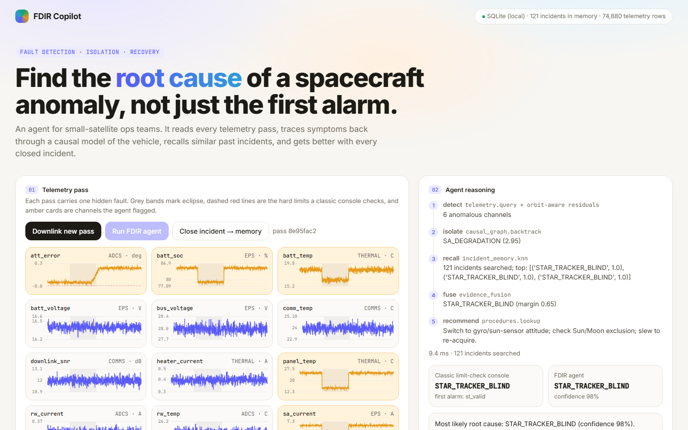
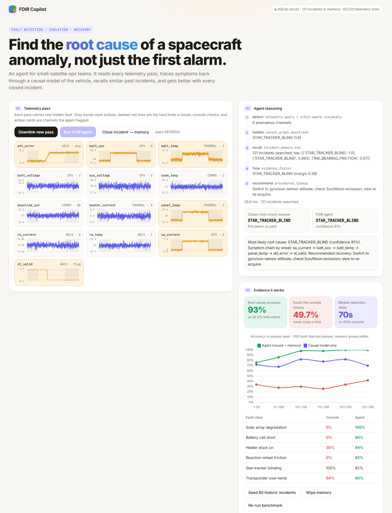
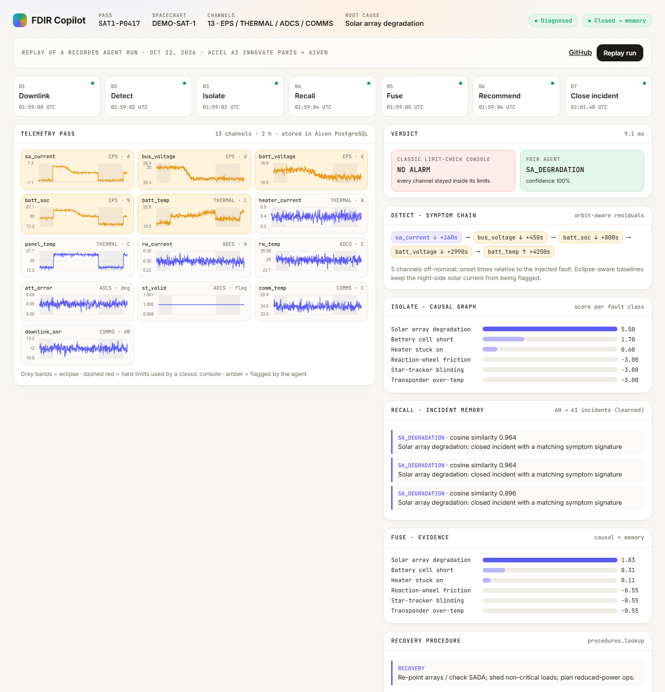
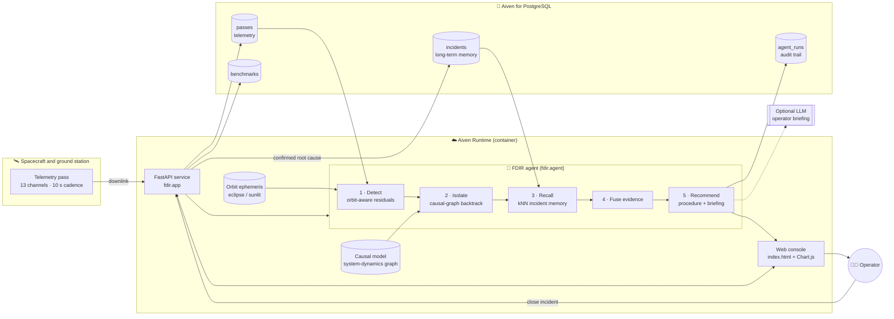
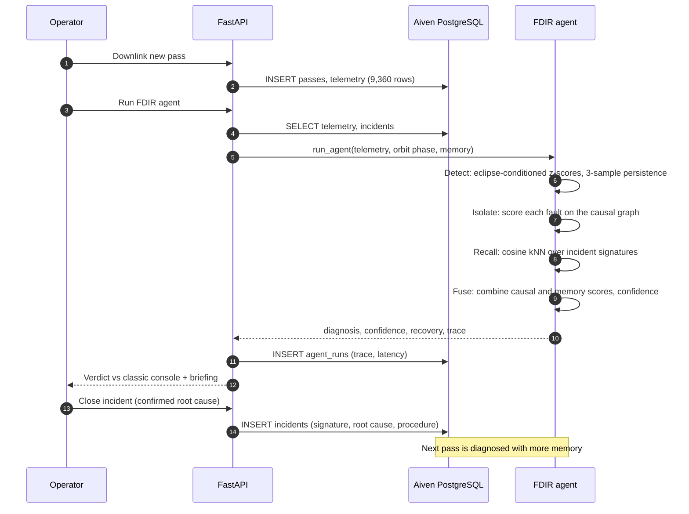
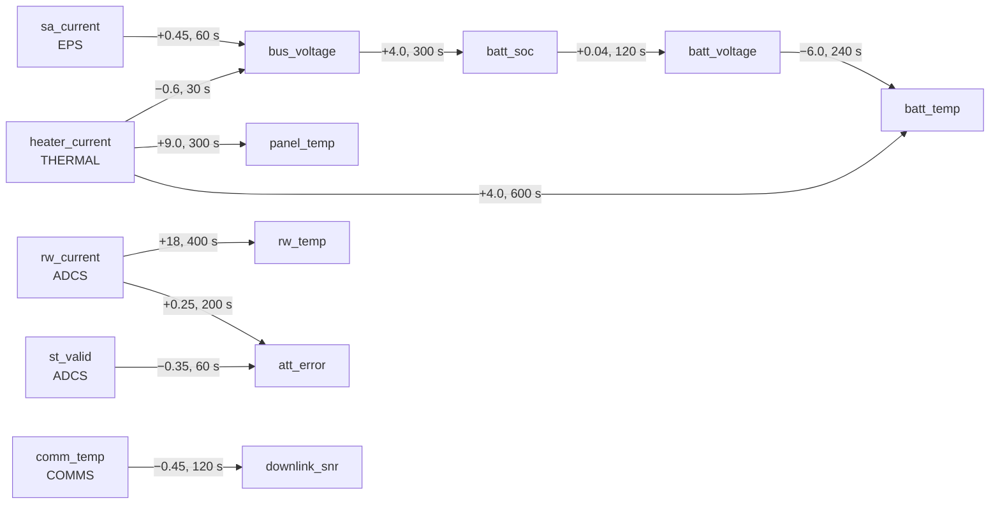
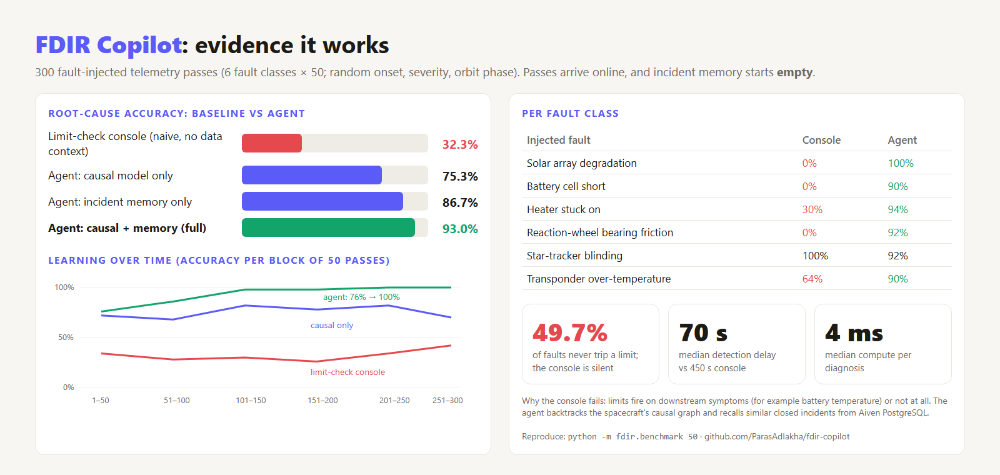

<div align="center">

# 🛰️ FDIR Copilot

**An AI flight controller that finds the _root cause_ of small-satellite anomalies, and learns from every incident.**

FDIR = **F**ault **D**etection, **I**solation & **R**ecovery


**93% root-cause accuracy vs 32% for a classic limit-check console · catches the 50% of faults that never trip a limit · 70 s median detection**

</div>



---

## 📌 Quick links

| What | Link |
|---|---|
| ▶️ Public replay of an agent run (GitHub Pages) | https://parasadlakha.github.io/fdir-copilot/ |
| 🎬 3-minute demo video | [demo.mp4](demo.mp4) |
| 💻 Source code | https://github.com/ParasAdlakha/fdir-copilot |
| 🚀 Live app (Aiven Runtime) | Deployed from this repo (see [Deploy on Aiven Runtime](#-deploy-on-aiven-runtime)) |
| 🖼️ Pitch deck | [PowerPoint](docs/FDIR_Copilot_Pitch.pptx) · [PDF](docs/FDIR_Copilot_Pitch.pdf) · [one-slide PNG](docs/images/pitch_slide.png) |
| 📊 Evidence / benchmark | [docs/images/evidence.png](docs/images/evidence.png) · [`fdir/benchmark.py`](fdir/benchmark.py) |
| 📝 Submission texts | [SUBMISSION.md](SUBMISSION.md) |
| 🏆 Hackathon | [Accel AI Innovate Paris: Future Founders](#-hackathon-context) · 22 October 2026 |
| 🧑‍🚀 Authors | [Paras Adlakha](https://github.com/ParasAdlakha) · [Harshita Adlakha](https://github.com/HarshitaAdlakha) |

---

## Table of contents
1. [Hackathon context](#-hackathon-context)
2. [The problem](#-the-problem)
3. [The solution](#-the-solution)
4. [Architecture](#-architecture)
5. [How the agent works](#-how-the-agent-works)
6. [The data layer in action](#-the-data-layer-in-action)
7. [Evidence it works](#-evidence-it-works)
8. [Run it locally](#-run-it-locally)
9. [Deploy on Aiven Runtime](#-deploy-on-aiven-runtime)
10. [API reference](#-api-reference)
11. [Repository structure](#-repository-structure)
12. [Go-to-market and roadmap](#-go-to-market-and-roadmap)
13. [Limitations](#-limitations)
14. [Authors](#-authors)

---

## 🏆 Hackathon context

Paras Adlakha and Harshita Adlakha designed and built FDIR Copilot in one day at **Accel AI Innovate Paris: Future Founders**, a hackathon hosted by [Accel](https://www.accel.com) for Europe's AI builders.

| | |
|---|---|
| **Event** | Accel AI Innovate Paris · *Future Founders* (one-day hackathon) |
| **Date and venue** | Thursday 22 October 2026 · Metafore Boétie St Augustin, Paris |
| **Host** | [Accel](https://www.accel.com) |
| **Partners** | [Aiven](https://aiven.io) (challenge sponsor) · [Lovable](https://lovable.dev) · Hackathon Hub · Iterate |
| **Agenda** | 08:00 registration · 09:00 build starts · 15:00 submissions · 16:00 top-8 pitching · 17:00 winners announced |
| **Team** | Paras Adlakha · Harshita Adlakha |

### The challenge brief
> Build a working product where one or more agents depend on data to deliver value for a specific user. That could mean querying large datasets, reacting to event streams, keeping long-term memory, combining many sources or improving over time from past runs. You choose the customer and the problem.
>
> Use any models, frameworks and tools you like. Deploy your app to our sponsor Aiven's Runtime, and use their managed data infrastructure for your data layer where relevant (PostgreSQL, ClickHouse, Valkey, OpenSearch and more) with free credits for every team.
>
> Strong teams need more than code. Product thinking, design and a credible route to first users all count.

### What the sponsor asked for, and how this project meets it

| Sponsor requirement | How FDIR Copilot meets it |
|---|---|
| Deploy the app to **[Aiven Runtime](https://aiven.io/runtime)** | Containerised with a `Dockerfile`, serves on port 8080, deployed from this GitHub repo through Runtime → *Deploy application* |
| Use **Aiven managed data infrastructure** for the data layer | **[Aiven for PostgreSQL](https://aiven.io/postgresql)** is the system of record: telemetry, incident memory, agent run logs and benchmarks. It is wired in through a Runtime service integration that exposes `DATABASE_URL` |
| Agents that **depend on data** | The agent cannot diagnose anything without the stored telemetry, the orbit context and its long-term incident memory |
| **Long-term memory / improving from past runs** | Every closed incident is written back to PostgreSQL; accuracy rises from 76% to 100% as memory fills |

### Judging criteria (each 20%) and where to look

| Criterion | Where it is addressed |
|---|---|
| **Customer problem & product value** | [The problem](#-the-problem): small-sat ops teams, symptom-based alarms, hours of manual forensics |
| **Agent capability** (multi-step reasoning, autonomy) | [How the agent works](#-how-the-agent-works): a 5-step loop (detect → isolate → recall → fuse → recommend) with a full trace |
| **Data at the core** (freshness, scale, grounding, memory) | [The data layer in action](#-the-data-layer-in-action): time-series telemetry, ephemeris grounding, causal model, persistent incident memory |
| **Evidence it works** (accuracy, latency, comparison) | [Evidence it works](#-evidence-it-works): 300-pass benchmark against a naive limit-check baseline, plus ablations |
| **Execution & pitch** | Polished web app, [public replay](https://parasadlakha.github.io/fdir-copilot/), [pitch deck](docs/FDIR_Copilot_Pitch.pptx), reproducible benchmark, a clear route to first users |

### Submission checklist

| Required item | Provided |
|---|---|
| Project name | FDIR Copilot |
| One-line pitch | See [SUBMISSION.md](SUBMISSION.md) |
| 3-minute demo (MP4) | [demo.mp4](demo.mp4); script in [SUBMISSION.md](SUBMISSION.md) |
| The data layer in action | [Section below](#-the-data-layer-in-action) |
| Evidence it works | [docs/images/evidence.png](docs/images/evidence.png) |
| One pitch slide | Slide 1 of the [deck](docs/FDIR_Copilot_Pitch.pptx) · [PNG](docs/images/pitch_slide.png) |
| GitHub repo *(optional)* | This repository |
| Demo link *(optional)* | [Public replay](https://parasadlakha.github.io/fdir-copilot/) · Aiven Runtime URL |

---

## 🎯 The problem

**Who:** small-satellite operators, meaning NewSpace start-ups and university CubeSat teams, where **2 to 5 operators** fly a growing fleet with no 24/7 flight-controller bench.

**Pain:** today's ground-segment consoles alarm on **hard-limit violations**. That fails in two ways:

1. **Limits fire on symptoms, not causes.** A degrading solar array first shows up as a battery-temperature or state-of-charge alarm, minutes after the real event. Operators then spend hours on telemetry forensics to work back to the cause.
2. **Many faults never cross a limit.** Slow degradations stay "in family" while the spacecraft drifts toward safe mode. In our benchmark, **49.7% of injected faults never trip a single limit.**

**Why now:** small-sat launches number in the thousands per year, while ops teams are not growing. Agents can now combine telemetry, a physics-informed causal model and institutional memory into one reasoning loop.

---

## 💡 The solution

FDIR Copilot is a web app plus an agent that:

- **Ingests** each downlinked telemetry pass into Aiven PostgreSQL.
- **Detects** off-nominal behaviour with orbit-aware baselines, so eclipse is not treated as a fault.
- **Isolates** the root cause by backtracking a **system-dynamics causal graph** of the spacecraft.
- **Recalls** similar past incidents from **long-term memory** in PostgreSQL.
- **Recommends** a recovery procedure, and writes an operator briefing.
- **Learns**: when an operator closes the incident, the confirmed root cause becomes new memory.



<sub>Left: the 13 telemetry channels of one pass (grey bands = eclipse, dashed red = hard limits, amber = flagged by the agent). Right: the agent's step-by-step reasoning, a side-by-side verdict against the classic console, and live evidence.</sub>

### ▶️ Public replay (no laptop needed)

[**parasadlakha.github.io/fdir-copilot**](https://parasadlakha.github.io/fdir-copilot/) replays a recorded agent run step by step: downlink → detect → isolate → recall → fuse → recommend → close incident. It is a static GitHub Pages site ([`docs/index.html`](docs/index.html)) driven by the run's real output ([`docs/replay.json`](docs/replay.json)). In this run the classic console raises **no alarm**, while the agent names the solar-array degradation with 100% confidence.



---

## 🏗️ Architecture



**Design choices**

| Choice | Why |
|---|---|
| PostgreSQL as the single system of record | Telemetry, memory and audit trail are relational and need to be queried together. One managed Aiven service keeps operations simple for a small team |
| Deterministic agent core, optional LLM | Flight operations need traceable, reproducible reasoning. The LLM only writes the human briefing and never makes the diagnosis |
| Causal graph *and* memory | The causal model generalises to faults never seen before; memory resolves the ambiguous cases the physics alone cannot (for example faults masked by eclipse) |
| SQLite fallback | The same code runs offline for development; setting `DATABASE_URL` switches it to Aiven PostgreSQL |

---

## 🤖 How the agent works



### Step by step

| # | Step | Tool | What it does |
|---|---|---|---|
| 1 | **Detect** | `telemetry.query` + orbit-aware residuals | Builds a nominal baseline per channel, separately for eclipse and sunlight (from the ephemeris). Flags a channel when \|z\| > 5 for 3 consecutive samples, and records onset time, sign and peak |
| 2 | **Isolate** | `causal_graph.backtrack` | For each fault class: is its root channel anomalous with the expected sign? Was it first? Are its downstream children anomalous? Are there anomalies it *cannot* explain (penalised)? |
| 3 | **Recall** | `incident_memory.knn` | Encodes the pass as a signature vector (signed onset order across channels) and finds the 5 nearest closed incidents in PostgreSQL by cosine similarity |
| 4 | **Fuse** | `evidence_fusion` | Combines normalised causal and memory scores. Confidence = sigmoid of the margin between the top two hypotheses |
| 5 | **Recommend** | `procedures.lookup` | Returns the recovery procedure for the diagnosed fault, plus an operator briefing (template, or an LLM if a key is configured) |

### The spacecraft causal model (system dynamics)

Each edge carries a gain and a transport delay. Faults are injected at a root node and propagate as first-order lags, which is why the *first alarm* is so often a downstream symptom.



### Fault library

| Fault class | Root channel | Recovery procedure |
|---|---|---|
| `SA_DEGRADATION` | `sa_current` ↓ | Re-point arrays / check SADA; shed non-critical loads |
| `BATTERY_CELL_SHORT` | `batt_voltage` ↓ | Isolate battery string; lower charge rate; power-safe mode |
| `HEATER_STUCK_ON` | `heater_current` ↑ | Cycle heater relay; switch to redundant thermostat |
| `RW_BEARING_FRICTION` | `rw_current` ↑ | Spin down wheel; 3-wheel + magnetorquer mode |
| `STAR_TRACKER_BLIND` | `st_valid` ↓ | Switch to gyro/sun-sensor attitude; slew to re-acquire |
| `TRANSPONDER_THERMAL` | `comm_temp` ↑ | Reduce TX duty cycle; switch to redundant transponder |

---

## 🗄️ The data layer in action

**What data the agent uses**

| Data | Where it lives | Role |
|---|---|---|
| **Telemetry passes**: 13 channels across EPS, thermal, ADCS and comms, 10 s cadence, 720 samples per pass (9,360 rows) | Aiven PostgreSQL · `passes`, `telemetry` | The raw evidence the agent queries on every run |
| **Orbit ephemeris** (eclipse / sunlit per sample) | Derived from the pass's orbit phase | Grounds the baselines, so 0 A of solar current in eclipse is *nominal* |
| **Spacecraft causal model** (gains and delays) | `fdir/sim.py` (`EDGES`) | Separates causes from symptoms |
| **Long-term incident memory** (signature, confirmed root cause, procedure, source) | Aiven PostgreSQL · `incidents` | kNN recall; grows with every closed incident |
| **Agent run log** (diagnosis, confidence, latency, full trace) | Aiven PostgreSQL · `agent_runs` | Audit trail for flight-safety review |
| **Benchmark results** | Aiven PostgreSQL · `benchmarks` | Evidence shown live in the app |

**Schema**

```sql
passes     (id, created_at, spacecraft, phase, truth_fault, truth_onset, status)
telemetry  (pass_id, idx, channel, value)            -- index on (pass_id, channel)
incidents  (id, created_at, pass_id, fault, signature, resolution, source)
agent_runs (id, created_at, pass_id, diagnosis, confidence, latency_ms, trace)
benchmarks (id, created_at, result)
```

**How it flows:** downlink → `telemetry` → agent (detect → isolate → recall over `incidents` → fuse → recommend) → `agent_runs` → operator closes the incident → `incidents`. **The next pass is diagnosed with more memory, so the product improves with use.**

---

## 📊 Evidence it works



**Protocol:** 300 telemetry passes (6 fault classes × 50), each with a random fault onset, severity (0.6× to 1.4×) and orbit phase. Passes arrive **online** in random order. Incident memory starts **empty** and grows only from closed incidents, just as it would in operations.

| Method | Root-cause accuracy |
|---|---|
| Classic limit-check console (naive baseline, no data context) | **32.3%** |
| Agent: causal model only (no memory) | 75.3% |
| Agent: incident memory only | 86.7% |
| **Agent: causal model + memory (full)** | **93.0%** |

| Metric | Limit-check console | FDIR agent |
|---|---|---|
| Faults never alarmed | **49.7%** | 0% |
| Median detection delay after onset | 450 s | **70 s** |
| Compute per diagnosis (median) | n/a | **~4 ms** |

**Learning over time** (accuracy per block of 50 passes): 76% → 86% → 98% → 98% → 100% → 100%.

**Reproduce it:**
```bash
python -m fdir.benchmark 50
```
Or click **Re-run benchmark** in the app.

---

## 🖥️ Run it locally

```bash
git clone https://github.com/ParasAdlakha/fdir-copilot.git
cd fdir-copilot
pip install -r requirements.txt
uvicorn fdir.app:app --port 8080
```
Open http://localhost:8080 (add `?demo=1` to downlink and diagnose a pass on page load).

| Environment variable | Purpose |
|---|---|
| `DATABASE_URL` | Aiven PostgreSQL connection string (falls back to local SQLite if unset) |
| `ANTHROPIC_API_KEY` | *Optional.* Enables LLM-written operator briefings |
| `FDIR_MODEL` | *Optional.* Model used for the briefing |

---

## 🚀 Deploy on Aiven Runtime

1. **Create the data service:** in the [Aiven Console](https://console.aiven.io), create an **Aiven for PostgreSQL** service.
2. **Deploy the app:** go to **Runtime → Deploy application**, connect GitHub, select `ParasAdlakha/fdir-copilot` on the `main` branch, scan, then deploy. The `Dockerfile` builds the image and the app listens on **8080**.
3. **Connect the database:** add a service integration of type `application_service_credential` from the PostgreSQL service and expose its connection string as **`DATABASE_URL`**.
4. **Verify:** open the app URL. The status pill should read **"Aiven PostgreSQL"**.

Docs: [Deploy apps](https://aiven.io/docs/products/runtime/deploy-apps) · [Connect services to apps](https://aiven.io/docs/products/runtime/connect-services-to-apps)

---

## 🔌 API reference

| Method | Endpoint | Description |
|---|---|---|
| `GET` | `/api/status` | Backend, memory size, telemetry row count |
| `POST` | `/api/pass?fault=` | Downlink a new pass (random hidden fault unless one is given) |
| `GET` | `/api/pass/{id}` | Telemetry, eclipse mask and channel metadata |
| `POST` | `/api/pass/{id}/diagnose` | Run the agent; returns diagnosis, confidence, trace, briefing and the console verdict |
| `POST` | `/api/pass/{id}/confirm` | Close the incident and write the confirmed root cause to memory |
| `POST` | `/api/memory/seed?n=` | Load historical anomaly reports (n per fault class) |
| `POST` | `/api/memory/reset` | Wipe incident memory |
| `GET`/`POST` | `/api/benchmark` | Latest benchmark / run a new one |

---

## 📁 Repository structure

```
fdir-copilot/
├── fdir/
│   ├── app.py          # FastAPI service and REST API
│   ├── agent.py        # 5-step FDIR agent + naive limit-check baseline
│   ├── sim.py          # Spacecraft telemetry simulator, causal graph, fault library
│   ├── db.py           # Data layer: Aiven PostgreSQL (DATABASE_URL) or SQLite fallback
│   ├── benchmark.py    # Online benchmark: baseline vs agent ablations
│   └── index.html      # Web console
├── docs/                       # Also served as the GitHub Pages site
│   ├── index.html              # Public step-by-step replay of an agent run
│   ├── replay.json             # Recorded output of that run
│   ├── FDIR_Copilot_Pitch.pptx # Pitch deck (7 slides, editable charts)
│   ├── FDIR_Copilot_Pitch.pdf
│   ├── images/                 # Screenshots, evidence chart, pitch slide
│   ├── evidence.html           # Source of the evidence chart
│   └── pitch_slide.html
├── demo.mp4                    # 3-minute demo video
├── bench_result.json   # Benchmark output (300 passes)
├── Dockerfile          # Container for Aiven Runtime
├── requirements.txt
└── SUBMISSION.md       # Hackathon submission texts and demo script
```

---

## 📈 Go-to-market and roadmap

**Route to first users**
- **Free tier for university CubeSat teams**, with open-source telemetry importers for YAMCS, OpenMCT and CCSDS packets.
- **Paid pilots with 3 seed-stage NewSpace operators**, priced per spacecraft per month.
- **Channels:** the SmallSat Conference, LibreCube and CubeSat communities, and launch-broker partnerships.

**Roadmap**
- Real telemetry ingestion (CCSDS / YAMCS) and validation on public datasets such as NASA SMAP/MSL ([Hundman et al., 2018](https://arxiv.org/abs/1802.04431)).
- Learn causal-graph gains and delays from fleet data, not hand-tuning.
- Streaming ingestion with Aiven for Apache Kafka; long-horizon trends in Aiven for ClickHouse.
- Multi-spacecraft fleet memory: one incident on satellite A pre-warns satellite B.
- Closed-loop recovery: draft the command sequence for operator approval.

---

## ⚠️ Limitations

- Telemetry is **simulated** with a physics-inspired causal model and injected faults. The benchmark shows the method's behaviour, not flight-validated performance.
- The fault library covers 6 classes; real missions need an FMEA-derived library per spacecraft.
- Memory uses exact kNN in application code. At fleet scale this would move to pgvector or OpenSearch.

---

## 👥 Authors

- **[Paras Adlakha](https://github.com/ParasAdlakha)**: background in aerospace, systems engineering and system dynamics.
- **[Harshita Adlakha](https://github.com/HarshitaAdlakha)**

FDIR Copilot applies the core ideas of spacecraft systems engineering (FDIR, FMEA, causal propagation with transport delays) to agentic AI. The point is to give small ops teams the reasoning that used to need a full flight-controller bench.

---

<div align="center">

Built by **Paras Adlakha** and **Harshita Adlakha** at **Accel AI Innovate Paris** · Data layer on **Aiven for PostgreSQL** · Deployed on **Aiven Runtime**

</div>
